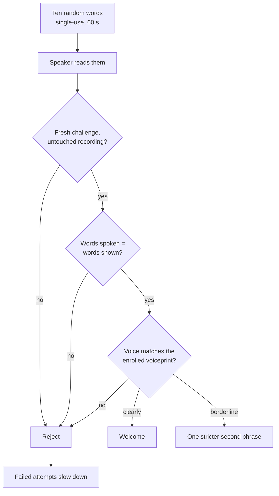

# KAVACH

**Voice authentication that listens to *how* you speak, not just *what* you sound like.**

KAVACH unlocks a screen when the right person reads ten random words aloud. It checks that the recording is
fresh, that the words are the ones on screen, and that the voice is the enrolled voice. A replayed recording,
a stranger reading the same words, and a clip that has been edited are all refused.

It is built for **Tamil–English code-switched speakers**: people who move between the two languages mid-sentence
and, without noticing, choose a language by subject (time and money in English, family and food in Tamil).
That habit is a second fingerprint, and the project's research core, the *Code-Switch Behaviour Graph*, is an
attempt to measure it.

---

## Why it exists

Voice biometrics have a known weakness: today's voice cloning needs only minutes of someone's speech. If the voice
is the whole secret, a good clone is the whole attack. KAVACH asks a sharper question: **can a speaker's
code-switching profile stay hard to steal after their voice and their secret answers have already been stolen?**

The project builds the system to test that, and is deliberately honest about how far the evidence goes.

---

## What it does

<table>
<tr>
<td width="50%" valign="top">

**Unlock**
Ten random words, single-use and time-limited. The voice must match the enrolled voiceprint as a *hard gate*:
nothing else can outvote it. No account to pick, no score on screen: the screen says *Welcome* or *Not recognised*.

**Enrolment and Studio**
Record sittings in the browser. Each ten-word clip is transcribed as you record so you can see the words were
read, and the voiceprint is rebuilt from your own microphone path.

**Dataset**
What has been recorded, per person and per sitting.

</td>
<td width="50%" valign="top">

**Graph Explorer**
Each speaker's code-switch behaviour across 21 concept classes, as a graph you can read.

**Attack Lab**
Replay, splicing, voice conversion and text attacks, run against the system and scored.

**Evaluation**
EER, minDCF and DET curves with confidence intervals, plus ablations, from the offline evaluation runs.

</td>
</tr>
</table>

### One login attempt



Speech before or after the phrase does not count toward the voice. A borderline voice gets one stricter second
chance rather than a pass. The voice threshold is *measured* from the speaker's own held-out recording sittings
against public speech corpora, never assumed.

---

## What the evidence says so far

A proof-of-concept evaluation for **one enrolled speaker** (the author, three recorded sittings), with a protocol
built to avoid flattering itself: thresholds are fitted without ever seeing the test trials, strangers are split
into separate fitting and test groups, and every rate carries its sample size and an interval.

| | ECAPA-TDNN | ResNet-TDNN | WavLM-SV |
|---|---|---|---|
| Equal error rate against 71 unseen strangers | 0.17% | 0.05% | 5.97% |
| Same protocol, 20 LibriSpeech enrollees | 0.22% | 0.11% | 3.31% |

The honest reading:

- **Separating the owner from strangers is the easy part.** The hard part is the *next sitting*: a new day scores
  lower, and the owner is wrongly refused about 7% of the time at a threshold fitted without the test data.
- **A threshold that stops strangers does not stop a clone.** A voice-conversion clone built from the owner's own
  recordings is accepted roughly a third of the time by a stranger-fitted threshold. That is exactly why the spoken
  challenge and the words check sit in front of the voice gate.
- **Scope.** One speaker, read speech, the voice embedding alone. Not a population result, not a spoofing-resistance
  result, and the code-switch graph has **not** been shown to add accuracy yet.

A pitfall worth knowing: comparing long enrolee clips against short stranger clips produced a *perfect* 0.00% error
in an early run. It was an artefact of clip length, and the evaluation now matches lengths.

---

## Try it

Windows, Python 3.10+ (3.11 recommended), Node 18+.

```powershell
# backend (the full requirements.txt adds the speech models: speechbrain, whisper)
py -3.11 -m venv .venv
.venv\Scripts\python.exe -m pip install -r requirements.txt

# front end
cd kavach
copy .env.example .env.local
npm install
cd ..

# run both: API on :8000, UI on :3000
powershell -ExecutionPolicy Bypass -File .\run_demo.ps1
```

Open `http://localhost:3000`. Without the speech models the API still starts in a degraded mode that says exactly
which parts are unavailable instead of faking a score.

```powershell
pytest        # the test suite, no GPU needed
```

A clone of this repository builds and passes its tests, but it **cannot reproduce the measured numbers**: the audio
is not here. It is biometric data from consenting participants, kept private on purpose. The developer guide
([DEVELOPMENT.md](DEVELOPMENT.md)) lists exactly what is missing and why.

---

## How it is built

| Piece | Choice |
|---|---|
| Speaker model | ECAPA-TDNN embeddings (SpeechBrain), cosine against an enrolled centroid; ResNet and WavLM compared |
| Speech recognition | Whisper (word timings, so the voice is judged only on the phrase) |
| Language ID | Word-level Tamil/English tagging with semantic concept classes |
| Code-switch model | Per-speaker graph over 21 concept classes, scored as a log-likelihood ratio |
| Backend | Python, FastAPI, SQLite |
| Front end | React, TypeScript, Vite |
| Evaluation | Leak-free, pre-registered protocol; EER, minDCF, DET, Wilson and cluster-bootstrap intervals |

Everything lives in `backend/kavach/` (system and evaluation), `kavach/` (UI) and `tests/`.

---

## Data and consent

Only people who agreed are recorded. Participant audio and voiceprints never enter the repository. The only voice
ever cloned for the attack tests is the author's own. Public corpora (LibriSpeech, Google's Tamil multi-speaker set)
serve as strangers.

---

## Credit

KAVACH began as [PremKxmar/speech](https://github.com/PremKxmar/speech). The research core (the Code-Switch
Behaviour Graph, word-level language ID, the threat model, the recording protocol) is Prem Kumar's work and his
history is preserved here. This repository continues from there with the live demo, the rebuilt interface, the
attack tooling and the evaluation described above.
